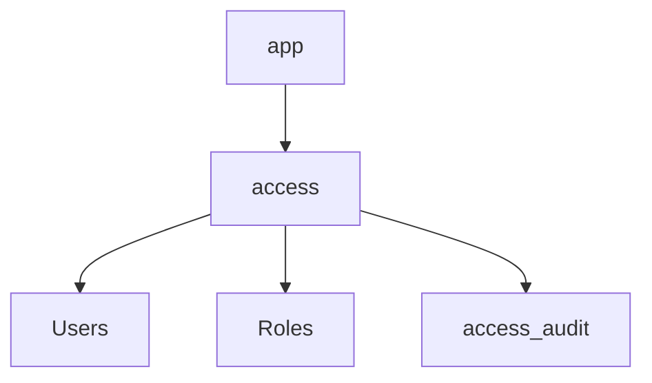

# Architecture

Why does `webtyp/access` exist? Auth and RBAC never meet. `webtyp/auth` manages identities (users, passwords, sessions) and `webtyp/rbac` manages permissions (roles, assignments). The logic to tie them together (e.g. create a user from an email and immediately assign a role) should not belong to either, nor should it be repeated in every application. This repo provides that bridge.

## Concepts

*   **Two Narrow Interfaces**: The `Module` expects an implementation for `Users` and `Roles`. `authority.Module` from auth and `rbac.Service` from rbac fit perfectly. The concrete types are wired by the application in its composition root.
*   **One Module = One Project**: A single `access.Module` serves exactly one `webtyp/rbac` project (`Deps.ProjectID`).
*   **Assurance Choice**: The operations can demand a single-factor session or a multi-factor session via `Deps.Assurance`.
*   **Wire Shapes**: The operations speak the standard list/save/delete JSON wire shapes required by `webtyp/view` and `crudview`.
*   **Audit Log**: The module owns the `access_audit` table. All changes via operations are audited.

## Flow

