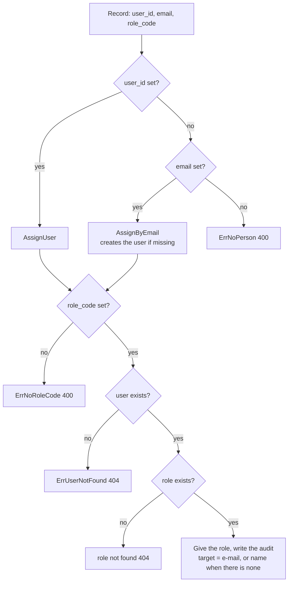

> Read AGENTS.md at the repo root before any change.

# Roles for people picked from a list

## Context

Today the "Assignments" screen asks for an **e-mail** and gives the role to the user with that e-mail, creating it if
missing (`Assign`, `crud.go:46`). Apps whose staff sign in with a national ID at a trusted LAN computer create their
users **without e-mail**, so nobody can be named in that form. Decision: the administrator **picks the person from a
list** of the app's users; the e-mail stays as an optional second way, only to invite someone who has never signed in.
The three screens are also grouped under **one** menu entry instead of three loose links.

- Today: [docs/img/assign-today-1.png](img/assign-today-1.png) — the form asks "Correo".
- Proposal: [docs/img/assign-proposal-1.png](img/assign-proposal-1.png) — the form asks "Persona" from a list; the
  optional "Invite by e-mail" field sits below it (not drawn in the mock-up).

How the list reaches the select: `layout/app.BuildMenu` fills a select from **another screen of the menu** that lists the
model named in the field's `Options` (`layout/app/menu.go:55`, `wireOptions`; error `errNoOptionSource` if none). So
access adds a read-only **People** screen (model `access_person`), and the assignment's `user_id` field takes its
options from it.

## Tools

```bash
go install webtyp.com/devflow/cmd/gotest@latest
go install webtyp.com/ormc/cmd/ormc@latest
go install webtyp.com/lang/cmd/langc@latest
go get webtyp.com/auth@v0.0.96
go mod tidy
```

`webtyp.com/auth` v0.0.96 is the tag that adds `(*authority.Module).ListUsers`. Environment:
`GOPRIVATE=webtyp.com/*,github.com/veltylabs/*`, `GOFLAGS=-mod=mod`.

## Ecosystem search

- Searched `ListPeople`, `Person`, `AssignUser`, `EnsureRoleFor`, `access_person` over `webtyp/` and `veltylabs/`: none exist.
- `auth` has a full users CRUD screen (`auth.NewView`) — **not reused**: it creates and deletes users by e-mail, which
  in a LAN-staff app belongs to the staff screen, not to role administration. People here is read-only.
- Menu groups already exist: `view.Screen.Children` (`webtyp/view/screen.go:45`), rendered by
  `layout.NewGroupUIModule` — **reuse**.
- Select options from another screen: `model.Field.Options` + `layout/app.wireOptions` — **reuse** (same as `role_code`).

## Design gate

1. **Prior art.** Keycloak's "Role mapping" and Google Workspace's "Assign role" both start from a list of existing
   users and pick one; inviting by e-mail is a separate action (unverified: pages not read in this session). Django
   admin assigns groups from the user's page, choosing from existing groups (unverified). Same split here: pick an
   existing person; invite by e-mail only when they do not exist yet.
2. **Novice names.** `m.ListPeople()`, `m.AssignUser(actor, userID, role)`, `m.AssignByEmail(actor, email, role)`,
   `m.EnsureRoleFor(code, name, description, userIDs)`, operation `access.list_people`, screen "People", group
   "Users and roles".
3. **Complexity ledger.** Concepts +1 (Person) · ways to assign: `Assign` is **deleted** and replaced by two names for
   two intents (existing user / invite), so a caller of the old ambiguous `Assign(string, string, string)` stops
   compiling instead of silently changing meaning · menu entries −2 (one group instead of three loose links).
4. **Where it belongs.** `access`, the only piece that knows users and roles together.
5. **Deletes.** `(*Module).Assign`; the three loose menu entries; the assignment form's mandatory e-mail.

## APIs used

| Symbol | Exact signature | Tag / file |
|---|---|---|
| `(*authority.Module).ListUsers` | `func (m *Module) ListUsers() ([]auth.User, error)` | `webtyp.com/auth` v0.0.96, `authority/ports.go` |
| `auth.User` | struct with `Id`, `Email`, `Name string` (and more) | `auth/models.go` |
| `view.Screen` | `struct { ID string; Label lang.Text; Icon string; Permission model.Resource; Presenter Presenter; Component dom.Component; Help lang.Text; Children []Screen }` — a group has `Children`, `Icon`, `Help` and no `Presenter`/`Permission` | `webtyp.com/view` (already required), `screen.go:37` |
| `view.NewCallerLister`, `view.Ops`, `view.New`, `view.WithTitle`, `view.WithDescription` | as used in `view.go` today | `webtyp.com/view` |
| `layout_app.BuildMenu` | `func BuildMenu(screens []view.Screen, ids model.IDGenerator, allows func(model.Resource) bool) (Menu, error)` — as called in `web/browser/main.go` | `webtyp.com/layout/app` |
| `rbac.IsRoleNotFound` | `func IsRoleNotFound(err error) bool` | `webtyp.com/rbac` (already used in `crud.go`) |

If a signature in the published tag differs from this table, stop and name the symbol in the PR; never adapt it by guessing.

## Stage 1 — diagram: `docs/diagrams/ASSIGN_FLOW.md` (new)

````markdown
# Assign flow

What `access.assign_roles` does with each record it receives. Every branch has a test in `tests/people_test.go`.


````

Commit after this stage.

## Stage 2 — tests first

Red until stage 3. Keep the existing helpers (`newEnv` in `tests/setup_test.go` returns the access module, the real
`*authority.Module` and the `*rbac.Service` on an in-memory store).

### 2a — `tests/people_test.go` (new, `package tests`)

Add a fake for the failure branch, in this file:

```go
// failingUsers is a Users whose list fails: the store is down.
type failingUsers struct{ access.Users }

var errUsersDown = errors.New("users store down")

func (failingUsers) ListUsers() ([]auth.User, error) { return nil, errUsersDown }
```

Build it with `access.New(access.Deps{DB: <same db as newEnv>, IDs: ids, Users: failingUsers{Users: authMod}, Roles: rbacSvc, ProjectID: "p1", Assurance: model.AssuranceSingleFactor})`
(if `newEnv` does not expose `db`/`ids`, create them in the test exactly as `newEnv` does).

Common setup (`setup := func(t) (m, authMod)`): `newEnv(t, model.AssuranceSingleFactor)`; `m.SaveRole("seed", access.RoleRecord{Code: "reception", Name: "Receptionist"})`;
`staff, _ := authMod.CreateUser("", "Staff One", "")` (no e-mail); `ana, _ := authMod.CreateUser("ana@example.com", "Ana", "")`.

| Test | Call | Expected |
|---|---|---|
| `TestAssignUser_PersonWithoutEmail` | `m.AssignUser("admin-1", staff.Id, "reception")` | `err == nil`; returned `Assignment{Id: "reception/"+staff.Id, UserId: staff.Id, Name: "Staff One", RoleCode: "reception"}`; `m.ListAssignments()` contains it; the last `m.ListAudit()` entry has `Target`/detail naming `"Staff One"` (no e-mail to show) |
| `TestAssignUser_Errors` (table) | `AssignUser` with: `("", "reception")`; `(staff.Id, "")`; `("missing-id", "reception")`; `(staff.Id, "nope")` | `ErrNoPerson`; `ErrNoRoleCode`; `ErrUserNotFound`; `rbac.IsRoleNotFound(err) == true` |
| `TestAssignByEmail_Invite` | `m.AssignByEmail("admin-1", "new@example.com", "reception")` | `err == nil`; `authMod.UserByEmail("new@example.com")` now exists; it holds the role |
| `TestListPeople_WithRoles` | after `AssignUser(staff → reception)` | `m.ListPeople()` has 2 people; `staff` → `Roles == "Receptionist"`, `Email == ""`; `ana` → `Roles == ""`, `Email == "ana@example.com"` |
| `TestListPeople_UsersDown` | access built with `failingUsers` | `ListPeople()` returns `errUsersDown`; calling `access.list_people` through `loopback.ActingAs("p1", "admin-1", m)` returns an error (status 500) |
| `TestEnsureRoleFor` | `m.EnsureRoleFor("admin", "Administrator", "", []string{staff.Id})`, twice | both `nil`; role `admin` exists once; `staff` holds it |
| `TestEnsureRoleFor_Errors` | `EnsureRoleFor("admin", "Administrator", "", []string{"missing-id"})`; `[]string{""}`; code `""` | `ErrUserNotFound`; `ErrNoPerson`; `ErrNoRoleCode` |

### 2b — operation tests: add to `tests/ops_test.go`

`TestOps_AssignRecords` through `loopback.ActingAs("p1", adm.Id, m)` and `access.OpAssignRoles`, one call per row:

| Records sent | Expected |
|---|---|
| `{UserId: staff.Id, RoleCode: "reception"}` | no error |
| `{Email: "invited@example.com", RoleCode: "reception"}` | no error; that user now exists |
| `{RoleCode: "reception"}` | error (400, text `ErrNoPerson`) |
| `{UserId: staff.Id, Email: "other@example.com", RoleCode: "reception"}` | no error; `authMod.UserByEmail("other@example.com")` still **not found** (a picked person wins over the e-mail: this is how an existing row is re-saved from the list) |

Add `access.OpListPeople` to the existing gate test so it requires `ResourceAssignment` read.

### 2c — update existing tests

- `tests/screens_test.go` `TestScreens`: `ui.Screens(caller)` returns **one** group screen with `ID == ui.ID`, a non-empty
  `Help`, no `Permission`, and 4 `Children` in this order: people, roles, assignments, audit, with permissions
  `ResourceAssignment, ResourceRole, ResourceAssignment, ResourceAudit`; every screen and child passes `Validate()`.
  Check `access.AssignmentModel`'s `user_id` field has `Options == &access.PersonModel` (keep the `role_code` check).
- Add `TestScreens_MenuWires` (in `tests/screens_test.go`): `layout_app.BuildMenu(ui.Screens(caller), ids, func(model.Resource) bool { return true })`
  returns no error (the People screen is the source of the person select). If `layout/app` cannot be imported in a
  native test, give this one test `//go:build wasm` and say so in the PR.
- `tests/ui_test.go` `TestItemizers`: `Assignment.Item()` label is now `Name` (`"Boss"`), description `"admin"`; add
  `Person{Id: "u1", Name: "Ana", Email: "ana@example.com", Roles: "Receptionist"}.Item()` → label `"Ana"`, description
  `"ana@example.com · Receptionist"` (descriptions of several fields are joined in field order, as `AuditEntry`'s are).
- Every call to `m.Assign(` in `tests/` becomes `m.AssignByEmail(` (same arguments).

Commit after this stage.

## Stage 3 — code

### `model.go`

Add, after `RoleRecordModel`:

```go
// PersonModel is a user of the app as the people screen lists it: someone a
// role can be given to. Not a table: people live in webtyp/auth.
var PersonModel = model.Definition{
	Name: "access_person",
	Fields: model.Fields{
		{Name: "id", Type: model.Text(), DB: &model.FieldDB{PK: true}},
		{Name: "name", Type: model.Text(), Label: "Name", Item: model.ItemLabel},
		{Name: "email", Type: model.Text(), Label: "E-mail", OmitEmpty: true, Item: model.ItemDescription},
		{Name: "roles", Type: model.Text(), Label: "Roles", OmitEmpty: true, Item: model.ItemDescription},
	},
}
```

Replace `AssignmentModel` with:

```go
var AssignmentModel = model.Definition{
	Name: "access_assignment",
	Fields: model.Fields{
		{Name: "id", Type: model.Text(), DB: &model.FieldDB{PK: true}},
		{Name: "user_id", Type: input.Select(), Label: "Person", OmitEmpty: true, Options: &PersonModel},
		{Name: "email", Type: input.Email(), Label: "Invite by e-mail", Help: "Only for someone who has never signed in. Leave it empty when you pick a person.", OmitEmpty: true},
		{Name: "role_code", Type: input.Select(), Label: "Role", NotNull: true, Item: model.ItemDescription, Options: &RoleRecordModel},
		{Name: "name", Type: model.Text(), OmitEmpty: true, Item: model.ItemLabel},
	},
}
```

Then run `ormc` at the repo root to regenerate `model_orm.go` (it adds `Person`, `PersonList` and updates
`Assignment`). Never edit `model_orm.go` by hand.

### `errors.go`

Add `ErrNoPerson domainError = "access: pick a person or give an e-mail"` and list it with the 400s in `statusOf`.

### `module.go`

- `Users` interface gains `ListUsers() ([]auth.User, error)` (comment: "every user of the app, for the people list").
- Extract the "create the role when missing" part of `EnsureRole` into `func (m *Module) ensureRole(code model.RoleCode, name, description string) error`
  (the `code == ""` check moves there) and call it from `EnsureRole`. Add:

```go
// EnsureRoleFor makes sure the role exists and every user in userIDs holds it:
// EnsureRole for people picked by id (people without e-mail). Idempotent.
//
// Example: err := m.EnsureRoleFor("admin", "Administrator", "", []string{firstAdmin.Id})
func (m *Module) EnsureRoleFor(code model.RoleCode, name, description string, userIDs []string) error {
	if err := m.ensureRole(code, name, description); err != nil {
		return err
	}
	for _, id := range userIDs {
		if id == "" {
			return ErrNoPerson
		}
		if _, err := m.users.UserByID(id); err != nil {
			return ErrUserNotFound
		}
		if err := m.roles.AssignRoleByCode(m.project, id, code); err != nil {
			return err
		}
	}
	return nil
}
```

### `crud.go`

Delete `Assign`. Add (same file):

```go
// AssignUser gives roleCode to an existing user, picked from ListPeople.
// Example: a, err := m.AssignUser(actorID, person.Id, "reception")
func (m *Module) AssignUser(actorUserID, userID, roleCode string) (Assignment, error) {
	if userID == "" {
		return Assignment{}, ErrNoPerson
	}
	if roleCode == "" {
		return Assignment{}, ErrNoRoleCode
	}
	u, err := m.users.UserByID(userID)
	if err != nil {
		return Assignment{}, ErrUserNotFound
	}
	return m.assign(actorUserID, u, roleCode)
}

// AssignByEmail gives roleCode to the person with that e-mail, creating the
// user when there is none: an invitation, before their first sign-in.
// Example: a, err := m.AssignByEmail(actorID, "ana@example.com", "reception")
func (m *Module) AssignByEmail(actorUserID, email, roleCode string) (Assignment, error) {
	email = normalizeEmail(email)
	if email == "" {
		return Assignment{}, ErrNoEmail
	}
	if roleCode == "" {
		return Assignment{}, ErrNoRoleCode
	}
	u, err := m.userByEmailOrCreate(email)
	if err != nil {
		return Assignment{}, err
	}
	return m.assign(actorUserID, u, roleCode)
}

func (m *Module) assign(actorUserID string, u auth.User, roleCode string) (Assignment, error) {
	if err := m.roles.AssignRoleByCode(m.project, u.Id, model.RoleCode(roleCode)); err != nil {
		return Assignment{}, err
	}
	if err := m.Record(actorUserID, AuditAssign, roleCode, auditTarget(u)); err != nil {
		return Assignment{}, err
	}
	return Assignment{Id: roleCode + AssignmentIDSeparator + u.Id, Email: u.Email, RoleCode: roleCode, UserId: u.Id, Name: u.Name}, nil
}

// auditTarget names a person in the audit: the e-mail, or the name when there is none.
func auditTarget(u auth.User) string {
	if u.Email != "" {
		return u.Email
	}
	return u.Name
}
```

In `Revoke`, record `auditTarget(u)` instead of `u.Email`. Note: `AssignUser` checks the role code **before** the
user, and an unknown role is reported by `AssignRoleByCode` (`rbac.IsRoleNotFound`) — keep that order.

### `queries.go`

```go
// roleNameSeparator joins the names of the roles a person holds.
const roleNameSeparator = ", "

// ListPeople returns every user of the app with the names of the roles they
// hold in this project: the list a role is given from.
// Example: people, err := m.ListPeople()
func (m *Module) ListPeople() ([]Person, error) {
	users, err := m.users.ListUsers()
	if err != nil {
		return nil, err
	}
	roles, err := m.ListRoles()
	if err != nil {
		return nil, err
	}
	assigned, err := m.ListAssignments()
	if err != nil {
		return nil, err
	}
	out := make([]Person, 0, len(users))
	for _, u := range users {
		p := Person{Id: u.Id, Name: u.Name, Email: u.Email}
		for _, a := range assigned {
			if a.UserId == u.Id {
				p.Roles = joinRoleName(p.Roles, roleName(roles, a.RoleCode))
			}
		}
		out = append(out, p)
	}
	return out, nil
}

func roleName(roles []RoleRecord, code string) string {
	for _, r := range roles {
		if r.Code == code {
			return r.Name
		}
	}
	return code
}

func joinRoleName(list, name string) string {
	if list == "" {
		return name
	}
	return list + roleNameSeparator + name
}
```

### `ops.go`

- Add `OpListPeople = "list_people"` to the operation names.
- In `MountOperations` (now eight operations; update its comment): `m.gate(reg.Operation(OpListPeople, m.opListPeople).Requires(ResourceAssignment, model.Read))`.
- Add:

```go
func (m *Module) opListPeople(ctx router.Context) {
	list, err := m.ListPeople()
	if err != nil {
		writeError(ctx, err)
		return
	}
	var res PersonList
	for i := range list {
		res = append(res, &list[i])
	}
	ctx.Encode(&res)
}

// assignRecord: a person picked from the list (user_id) wins over the e-mail —
// that is how a row loaded from the list is saved again; the e-mail alone invites.
func (m *Module) assignRecord(actorUserID string, rec Assignment) (Assignment, error) {
	if rec.UserId != "" {
		return m.AssignUser(actorUserID, rec.UserId, rec.RoleCode)
	}
	if rec.Email != "" {
		return m.AssignByEmail(actorUserID, rec.Email, rec.RoleCode)
	}
	return Assignment{}, ErrNoPerson
}
```

- In `opAssignRoles`, replace `m.Assign(actor, rec.Email, rec.RoleCode)` with `m.assignRecord(actor, rec)`.

### `view.go`

Add `TitlePeople = "People"` to the titles and:

```go
// NewPeopleView builds the Presenter for the people list (read-only): the
// source of the person select in the assignments form.
func NewPeopleView(caller router.Caller, opts ...view.Option) view.Presenter {
	b := view.NewCallerLister(caller,
		view.Ops{Module: ModelName, List: OpListPeople},
		func() model.ModelSlice { return &PersonList{} },
	)
	return view.New(b, &Person{}, append([]view.Option{view.WithTitle(TitlePeople)}, opts...)...)
}
```

### `ui/` — one menu entry for the whole module

`ui/module.go`: add `LabelGroup = "Users and roles"`, `LabelPeople = "People"`,
`helpGroup lang.Text = "Who can use the app and what each person may do."`,
`descPeople lang.Text = "Everyone who uses the app, with their roles."`, `IconPeople = svg.Icon("access_people")`.

`ui/svg.go`: add to the sprite:

```go
sprite.Define(IconPeople, "0 0 16 16",
	sprite.Path("M5.5 2a2.5 2.5 0 1 0 0 5 2.5 2.5 0 0 0 0-5zM11 3a2 2 0 1 0 0 4 2 2 0 0 0 0-4zM1 13c0-2 2-3.5 4.5-3.5S10 11 10 13v1H1v-1zm10-3c2 0 4 1 4 3v1h-4v-1c0-1-.4-2.1-1.1-2.8.4-.1.7-.2 1.1-.2z"),
),
```

`ui/browser.go` — `Screens` returns **one group**; the leaves keep their IDs, labels, icons and permissions:

```go
func Screens(caller router.Caller) []view.Screen {
	return []view.Screen{{
		ID: ID, Label: LabelGroup, Icon: string(IconPeople), Help: helpGroup,
		Children: []view.Screen{
			{ID: ID + ".people", Label: LabelPeople, Icon: string(IconPeople), Permission: access.ResourceAssignment,
				Presenter: access.NewPeopleView(caller, view.WithDescription(descPeople))},
			{ID: ID + ".roles", Label: LabelRoles, Icon: string(IconRoles), Permission: access.ResourceRole,
				Presenter: access.NewRolesView(caller, view.WithDescription(descRoles))},
			{ID: ID + ".assignments", Label: LabelAssignments, Icon: string(IconAssignments), Permission: access.ResourceAssignment,
				Presenter: access.NewAssignmentsView(caller, view.WithDescription(descAssignments))},
			{ID: ID + ".audit", Label: LabelAudit, Icon: string(IconAudit), Permission: access.ResourceAudit,
				Presenter: access.NewAuditView(caller, view.WithDescription(descAudit))},
		},
	}}
}
```

### `seed/seed.go`

`m.Assign(actorID, "admin@example.com", "admin")` → `m.AssignByEmail(actorID, "admin@example.com", "admin")`.

Run `gotest`: everything green. `grep -rn "\.Assign(" --include=*.go .` → empty. Commit after this stage.

## Stage 4 — translations

Run `langc sync .`, then fill every empty value in `lang.json` for all its languages (`es zh hi ar pt fr de ru`):
"Person", "Invite by e-mail", "Only for someone who has never signed in. Leave it empty when you pick a person.",
"People", "Users and roles", "Who can use the app and what each person may do.",
"Everyone who uses the app, with their roles.", "Roles". Spanish: "Persona", "Invitar por correo", "Solo para alguien
que nunca ha entrado. Déjalo vacío si eliges a una persona.", "Personas", "Usuarios y roles", "Quién puede usar la
aplicación y qué puede hacer cada persona.", "Todas las personas que usan la aplicación, con sus roles.", "Roles".
`langc sync .` must report zero untranslated keys and zero reuse warnings. Commit after this stage.

## Stage 5 — docs

- `README.md`: operations table gains `access.list_people | access_assignment | read | (None)`; the `assign_roles`
  row's arguments become `{"records":[{"user_id"|"email","role_code"}]}`; "I want X → use Y" gains
  "give a role to someone without e-mail → pick them in People/Assignments, or `m.AssignUser`" and
  "make sure the first admin (picked by id) holds a role → `m.EnsureRoleFor(...)`"; Quick start mentions that the menu
  shows one "Users and roles" entry.
- `docs/ARCHITECTURE.md`: a short section "People and assignments" — the people list comes from `Users.ListUsers`;
  a picked person wins over the e-mail; link `docs/diagrams/ASSIGN_FLOW.md` and the two screenshots in `docs/img/`.

Commit after this stage.

## Delivery check

1. `gotest` passes. A PR that does not compile, or whose tests could not run, is a failed delivery.
2. `grep -rn "\.Assign(" --include=*.go .` → empty; `grep -n "OpListPeople" ops.go` → present.
3. `langc sync .` → zero untranslated, zero reuse warnings.
4. `git diff --stat main` lists: `docs/diagrams/ASSIGN_FLOW.md`, `tests/people_test.go`, `tests/ops_test.go`,
   `tests/screens_test.go`, `tests/ui_test.go`, `model.go`, `model_orm.go`, `errors.go`, `module.go`, `crud.go`,
   `queries.go`, `ops.go`, `view.go`, `ui/module.go`, `ui/svg.go`, `ui/browser.go`, `seed/seed.go`, `lang.json`,
   `README.md`, `docs/ARCHITECTURE.md`, `go.mod`, `go.sum`; plus any other `tests/` file whose `m.Assign(` was renamed.

## Delivery rules

- Never pause to ask permission or report progress: when the delivery check passes, commit, push and open the PR. Stuck
  for 30 minutes: open the PR anyway, listing what fails.
- Commit after every stage. Never run `git reset`, `git restore`, `git checkout -- <file>` or `git stash` on your own work.
- Never edit `model_orm.go`: a build error there means `model.go` is wrong; fix it and run `ormc` again.
- Do not import `webtyp.com/auth/authority` outside `tests/` (AGENTS.md).

## Stages

| # | Files | Result |
|---|---|---|
| 1 | `docs/diagrams/ASSIGN_FLOW.md` | The flow, one branch per test |
| 2 | `tests/people_test.go`, `tests/ops_test.go`, `tests/screens_test.go`, `tests/ui_test.go` | Successes and failures, red |
| 3 | `model.go`, `model_orm.go`, `errors.go`, `module.go`, `crud.go`, `queries.go`, `ops.go`, `view.go`, `ui/*`, `seed/seed.go` | People list, pick a person, one menu group; green |
| 4 | `lang.json` | Every new text translated |
| 5 | `README.md`, `docs/ARCHITECTURE.md` | Documented with diagram and screenshots |
